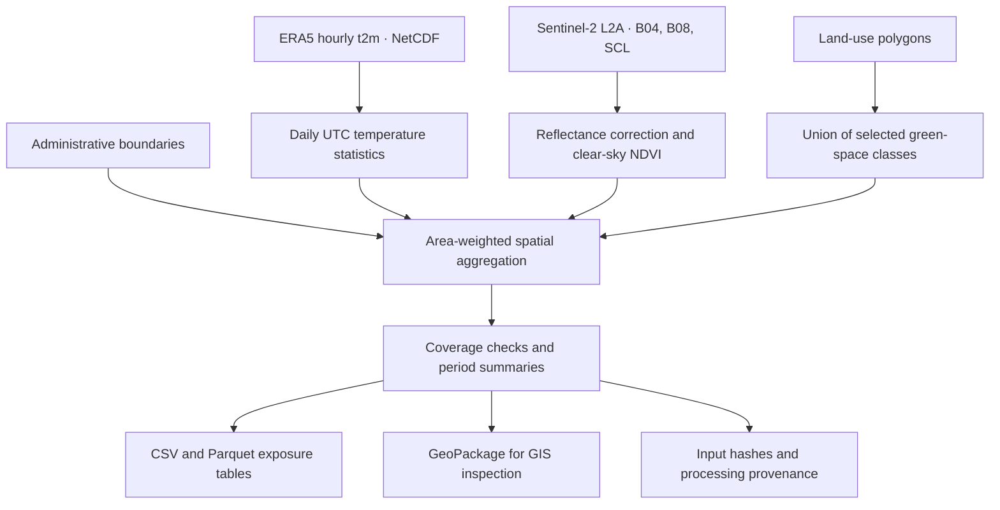

# Environmental Exposure Mapping & Data Pipeline

### Urban heat and green space · Bremen, Germany

A Python geospatial workflow that integrates ERA5 air temperature, Sentinel‑2 vegetation observations, and land-use polygons into area-level exposure tables for environmental health research.

The project focuses on a practical research problem: **how can heterogeneous environmental datasets be converted into transparent, spatially consistent variables that can later be linked to health outcomes?**

**Status:** working research prototype with an end-to-end synthetic demonstration. Real-data analysis for Bremen and external validation have not yet been completed. The example results below demonstrate software behaviour, not environmental conditions in Bremen.

[Quick start](#quick-start) · [Methods](#methods) · [Real-data workflow](#real-data-workflow) · [Limitations](#limitations-and-research-interpretation)

## Research purpose

Urban heat and green space are relevant dimensions of environmental exposure, but their source datasets differ in spatial resolution, temporal coverage, and measurement meaning. This workflow prepares them for joint analysis while retaining those distinctions.

It supports exploratory questions such as:

- How do area-weighted temperature summaries and mapped green-space fractions vary across administrative areas?
- Which areas have sufficient climate, land-use, and clear-sky vegetation coverage for comparison?
- How can daily environmental exposures be prepared for linkage to area-level health data?

The implementation demonstrates geospatial data integration, remote-sensing preprocessing, exposure-variable construction, missing-data handling, and reproducible Python workflows. It does not estimate health effects or implement a causal model.

## Workflow



Daily temperature and land-use variables are exported together. NDVI is exported by zone and scene, with scene-based summaries added to the zone/year table when suitable imagery is available.

## Quick start

The demonstration runs locally without external accounts, downloads, or API credentials. It creates its own synthetic inputs.

From the repository root, using Python 3.9 or later:

```bash
python3 -m venv .venv
.venv/bin/python -m pip install -r requirements.txt
.venv/bin/python -m pytest -q
.venv/bin/python -m bremen_exposure.demo
```

Explicit interpreter paths avoid dependence on shell activation or an existing Conda environment. These commands target macOS/Linux. On Windows, use `.venv\Scripts\python.exe` instead of `.venv/bin/python`.

A successful demonstration prints:

```text
Wrote 6 zone-days and 2 zone-years to .../outputs/demo
```

Inspect selected results:

```bash
.venv/bin/python -c "import pandas as pd; print(pd.read_csv('outputs/demo/exposure_annual.csv')[['zone_id', 'green_fraction', 'tmax_mean_c', 'hot_days_observed', 'ndvi_scene_mean']].to_string(index=False))"
```

Open `outputs/demo/exposure.gpkg` in QGIS to inspect the spatial output.

### Demonstration results

The demonstration contains two rectangular zones near Bremen, three days of synthetic hourly temperatures, and one synthetic vegetation scene. The polygons are not official administrative boundaries; the raster is not at Sentinel‑2 spatial resolution.

| Synthetic zone | Green-space fraction, rounded | Mean of daily Tmax | Observed hot days | Mean NDVI |
|---|---:|---:|---:|---:|
| DEMO_WEST | 0.50 | 32°C | 3 | 0.20 |
| DEMO_EAST | 0.80 | 33°C | 3 | 0.50 |

Small deviations in area fractions reflect polygon projection and intersection calculations. `synthetic=true` identifies the example exposure tables. These values are constructed inputs and must not be interpreted as an observed relationship between vegetation and temperature.

Version-controlled examples: [daily exposures](examples/exposure_daily.csv), [period summaries](examples/exposure_annual.csv), and [scene-level NDVI](examples/ndvi_zone_scene.csv).

## Methods

### Air temperature

The ERA5 adapter reads hourly `t2m` in Kelvin, converts it to degrees Celsius, and calculates daily mean, minimum, and maximum values on the source grid.

- Days follow **UTC**, with 24 valid hourly observations required for each cell.
- Incomplete cell-days remain missing; there is no temporal filling.
- Daily extrema are the minimum and maximum of hourly instantaneous samples. They may miss extrema between observations.
- Each zone receives an area-weighted mean of the valid daily raster values.

For each valid zone-day, a hot day is defined as a zone-average Tmax of at least 30°C. The threshold follows the [DWD definition of a hot day](https://www.dwd.de/DE/service/lexikon/Functions/glossar.html?lv3=101162); this implementation applies it to the spatial average of hourly sampled maxima.

`warm_minimum_days_observed` counts zone-days with mean Tmin ≥20°C. This is a daily-minimum indicator, not a separate analysis of tropical nights.

### Vegetation from Sentinel‑2

The Sentinel‑2 adapter uses Level‑2A B04 (red), B08 (near-infrared), and Scene Classification Layer (SCL) inputs:

```text
reflectance = (DN + band_offset) × scale
NDVI = (B08_reflectance − B04_reflectance)
       / (B08_reflectance + B04_reflectance)
```

Scale and offsets must be supplied from the product metadata. B04 and B08 must share a grid; SCL is aligned with nearest-neighbour resampling. Only SCL classes 4, 5, and 6 are retained. Invalid pixels, raw zero values, negative corrected reflectances, and non-positive denominators are excluded.

Zone-level NDVI uses valid pixel intersection areas as weights. Period summaries average accepted scene-level zone means with equal weight per scene. They are not per-pixel seasonal median composites.

### Green-space fraction

Selected land-use polygons are unioned before intersection to prevent double counting:

```text
green_fraction = area(zone ∩ union(selected green classes)) / area(zone)
```

The example research configuration selects Urban Atlas 2018 classes `14100` (green urban areas) and `31000` (forests). This is an explicit operational definition, not a measure of all vegetation or public access. Other classification years require reviewing the class codes.

Area calculations use **EPSG:3035**, a European equal-area projection. Temperature and NDVI weights are calculated from pixel–zone intersections, with intersection areas measured in the same projection.

### Coverage and missing values

The configurable `minimum_coverage` threshold defaults to 0.90 and is used for spatial and temporal acceptance.

| Check | Behaviour |
|---|---|
| Insufficient valid raster coverage | Zone temperature or NDVI mean is missing |
| Insufficient land-use coverage | `green_fraction` is missing; observed green area is retained |
| Missing date or temperature variable | Daily record remains present with missing temperature |
| Insufficient valid days within the requested period | Temperature means and exceedance fractions are missing |
| Partially observed period | Exceedance counts remain explicitly labelled `observed` |
| Invalid polygons, duplicate raster date/variable pairs, inconsistent temperatures | Processing raises an error |

Missing values are not converted to zero. Counts of observed hot days must be interpreted alongside valid-day counts and temporal coverage.

## Real-data workflow

### 1. Prepare inputs

| Input | Required content | Source / guidance |
|---|---|---|
| Administrative zones | Single-layer GeoPackage or GeoJSON; valid polygons, CRS, unique non-null text IDs | [GeoPortal Bremen](https://www.geo.bremen.de/online-dienste/geoportal-bremen-14419) |
| ERA5 NetCDF | Hourly `t2m` in K; `time` or `valid_time`, `latitude`, `longitude` dimensions | [ECMWF ERA5](https://www.ecmwf.int/en/forecasts/dataset/ecmwf-reanalysis-v5) |
| Sentinel‑2 L2A | Matching B04/B08 grids, SCL, product scale and offsets | [Product documentation](https://sentiwiki.copernicus.eu/web/s2-products) |
| Land use | Polygon layer containing all classes across the study area, including non-green classes | [Copernicus Urban Atlas](https://land.copernicus.eu/en/products/urban-atlas?tab=land_coverland_use) |

Choose the **city of Bremen** boundary scope deliberately; the federal state also includes Bremerhaven. Record the administrative level, boundary year, source, download date, and data licence. Check for overlapping zone polygons before processing.

Use a regional ERA5 grid covering all study polygons with a margin. The adapter requires a regular latitude/longitude grid with at least two rows and columns and longitude coordinates in −180…180. Select any ensemble-member or `expver` dimension before input. ERA5-Land can use the same adapter when it follows the supported schema.

Crop imagery to the study area before processing. Mosaic same-day Sentinel tiles before creating the NDVI manifest; only one scene entry per date is supported.

### 2. Convert ERA5 and prepare NDVI

```bash
.venv/bin/python -m bremen_exposure.prepare era5 data/era5.nc data/era5_daily
```

The following Sentinel command is an **example only**, for metadata specifying a quantification value of 10000 and band offsets of −1000:

```bash
.venv/bin/python -m bremen_exposure.prepare sentinel \
  data/B04.jp2 data/B08.jp2 data/SCL.jp2 data/sentinel/ndvi_20230702.tif \
  --scale 0.0001 --red-offset -1000 --nir-offset -1000
```

Use the actual metadata for your product. Harmonized or already corrected products may need different parameters. The Sentinel adapter uses the explicit supplied parameters rather than automatically applying stored raster scale/offset metadata. For reflectance inputs, use scale 1 and offsets 0 and review the nodata convention.

Create `data/sentinel/ndvi.csv`:

```csv
date,path
2023-07-02,ndvi_20230702.tif
2023-07-12,ndvi_20230712.tif
```

The ERA5 adapter creates its climate manifest automatically. Alternatively, supply daily single-band temperature GeoTIFFs with a CRS, declared nodata, and this schema:

```csv
date,variable,path,unit
2023-07-01,tmean,20230701_tmean.tif,C
2023-07-01,tmax,20230701_tmax.tif,C
2023-07-01,tmin,20230701_tmin.tif,C
```

Supported variables are `tmean`, `tmax`, and `tmin`; supported temperature units are `C` and `K`. The temperature reader applies stored raster scales and offsets. Inputs must represent air temperature rather than land-surface temperature.

### 3. Configure and run

Edit [config/research.json](config/research.json) to match your paths, zone IDs, land-use classification field and codes, source description, reference year, and study dates.

```bash
.venv/bin/python -m bremen_exposure.pipeline config/research.json
```

Configuration paths are relative to the configuration file. Raster paths inside manifests are relative to their manifest. The NDVI manifest is optional: omit `ndvi_manifest` if vegetation imagery is unavailable.

To include adapter provenance in the final run record, add:

```json
"preparation_records": [
  "../data/era5_daily/preparation.json",
  "../data/sentinel/ndvi_20230702.tif.json"
]
```

Include records for each scene used in the analysis. The default research configuration references 2018 land use and a summer 2023 climate period as setup examples; this temporal mismatch must be justified or changed for an actual study.

## Outputs and health-data linkage

| Output | Unit of observation / purpose |
|---|---|
| `exposure_daily.csv` / `.parquet` | One row per zone and date; daily temperatures, coverage, and static land-use metrics |
| `exposure_annual.csv` / `.parquet` | One row per zone and year, summarizing only the requested dates within that year; includes NDVI summaries when available |
| `ndvi_zone_scene.csv` | One row per zone and available image date |
| `exposure.gpkg` | `zone_year` polygon layer for GIS inspection |
| `provenance.json` | Configuration, input SHA‑256 hashes, processing time, library versions, and optional adapter records |

The filename `exposure_annual` does **not** imply a complete calendar year: check `expected_days`, study dates, and valid-day counts. A summer-only run produces summer summaries within each year.

Tables can be joined to area-level health records using `(zone_id, date)` or `(zone_id, year)`, after matching temporal definitions and study windows. No health records are included. All spatial summaries are area-weighted, not population-weighted.

The [data dictionary](DATA_DICTIONARY.md) defines the exported variables and units. For daily health outcomes dated in German local time, adapt the current UTC aggregation before linkage. Any lag variables should be constructed within each zone on a complete daily index, preserving missing values.

## Validation and reproducibility

Six automated tests cover:

1. Pixel–polygon area weighting and nodata coverage.
2. Overlapping green polygons and incomplete land-use coverage.
3. Missing days and temperature-threshold boundary values.
4. Incomplete ERA5 hourly days.
5. Sentinel cloud masking and reflectance offsets.
6. End-to-end processing and expected synthetic exposure values.

The workflow has been tested locally on macOS ARM with Python 3.9. `requirements.txt` defines dependency ranges; `requirements-lock.txt` records that tested environment rather than a universal cross-platform lock.

The current tested environment emits Affine deprecation warnings and a NumPy/NetCDF binary-compatibility warning. Tests and the synthetic run pass, but dependency compatibility should be resolved and rechecked before a substantive research run. Tests establish computational behaviour; they do not establish real-world exposure validity.

Raw research inputs, generated outputs, the virtual environment, and caches are excluded from Git. Small synthetic CSV snapshots are included under `examples/`. Adapter records and the final provenance file support tracing results to the local input files.

## Limitations and research interpretation

- **Temperature resolution:** [ERA5 has an approximately 31 km native resolution](https://confluence.ecmwf.int/pages/viewpage.action?pageId=673339992); [ERA5-Land is approximately 9 km](https://www.ecmwf.int/en/forecasts/dataset/ecmwf-reanalysis-v5-land). Small neighbourhoods may receive similar values. Sentinel vegetation data do not downscale temperature or independently measure urban heat-island intensity.
- **Exposure definition:** applying a threshold to zone-average Tmax differs from averaging cell-level exceedance counts. This implementation uses the former.
- **Time alignment:** UTC days, hourly sampled extrema, static land-use years, and irregular clear-sky imagery require deliberate alignment with health outcomes.
- **Vegetation sampling:** SCL masking can retain residual contamination. Scene availability and the conservative mask can bias vegetation summaries. The workflow does not implement cloud buffering or seasonal per-pixel compositing.
- **Spatial processing:** intersection-based weighting can be slow for large high-resolution rasters. Transformed geographic cell boundaries use straight polygon edges without geodesic densification. Raster rotation is not supported.
- **Inference:** area-level exposure is not personal exposure. The pipeline does not account for mobility, indoor conditions, population distribution, confounding, or causal identification.
- **Validation scope:** real Bremen inputs have not been processed or compared with independent observations in this repository.

## Next research steps

Planned extensions, not current capabilities:

- Apply the workflow to official Bremen boundaries and a documented real-data study period.
- Compare gridded temperature with independent local observations.
- Evaluate sensitivity to geographic scale, land-use year, and coverage thresholds.
- Add local-calendar daily aggregation and population-weighted exposures.
- Assess seasonal vegetation composites and cloud-mask sensitivity.
- Develop a separately specified statistical analysis once health data and a study design are available.

## Repository structure

```text
bremen_exposure/
  prepare.py             ERA5 and Sentinel-2 preprocessing adapters
  pipeline.py            Spatial aggregation, quality checks, and exports
  demo.py                Reproducible synthetic input generation and full run
config/
  research.json          Example configuration for user-supplied research data
examples/                Synthetic CSV result snapshots
tests/
  test_pipeline.py       Unit and end-to-end tests
DATA_DICTIONARY.md        Field definitions, units, and interpretation
requirements.txt         Dependency ranges
requirements-lock.txt    Tested environment snapshot
```

## Data acknowledgements

The real-data workflow is designed around ECMWF/Copernicus ERA5, Copernicus Sentinel‑2, Copernicus Urban Atlas, and official Bremen geodata. See the linked providers for access conditions, product documentation, and dataset citation requirements. The repository contains synthetic examples; it does not redistribute those research datasets. A validated empirical study should cite the exact products, releases, and acquisition periods used.
